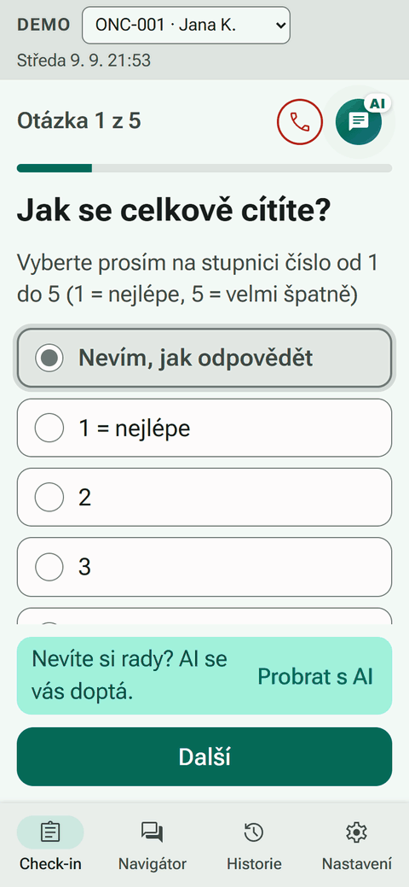
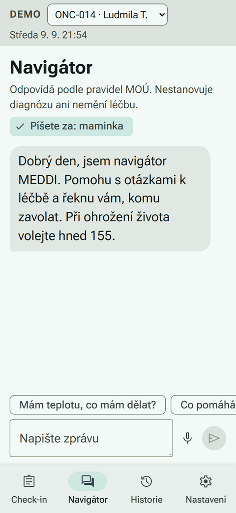
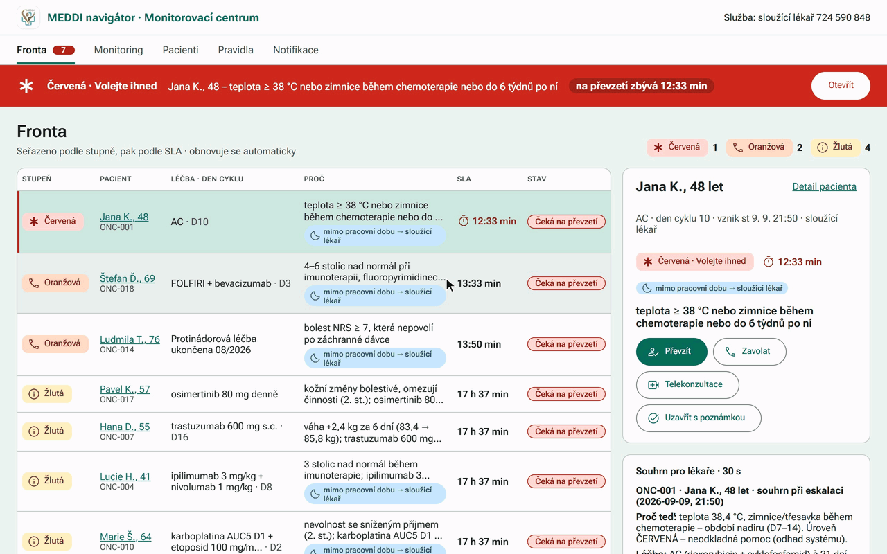
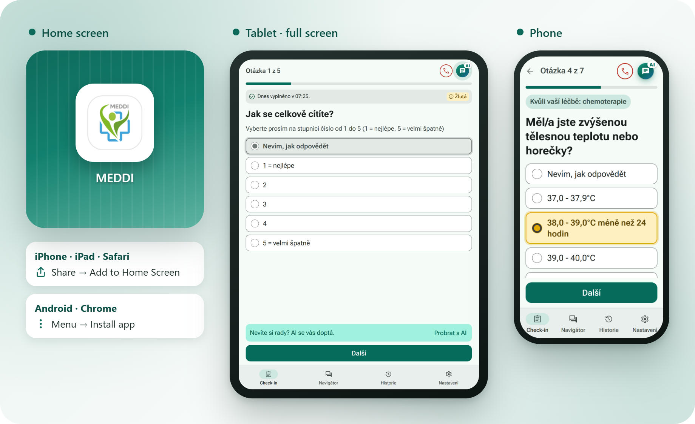
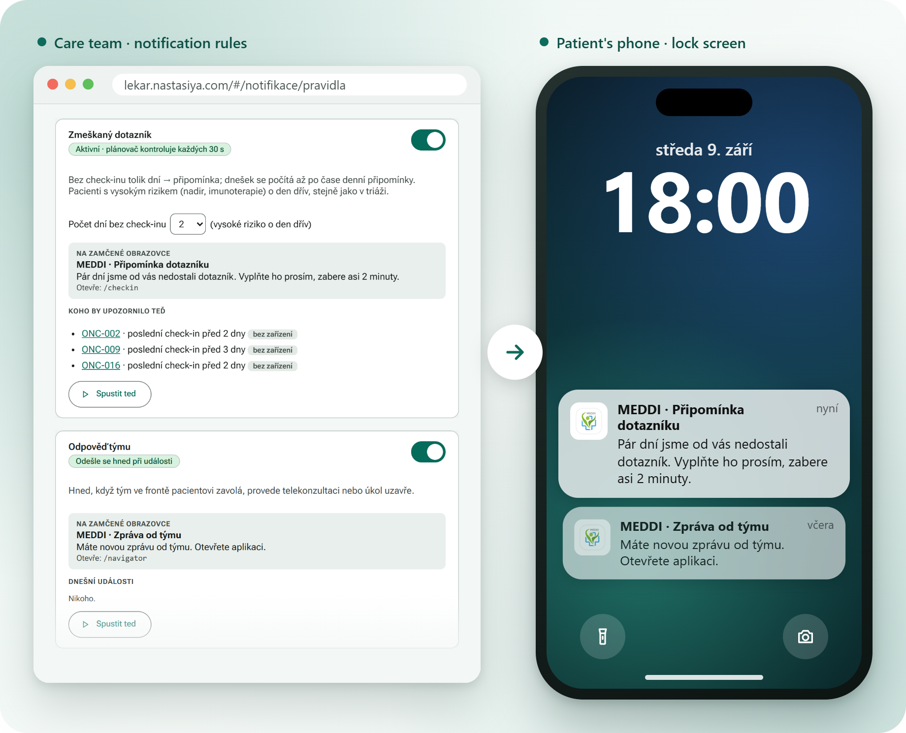
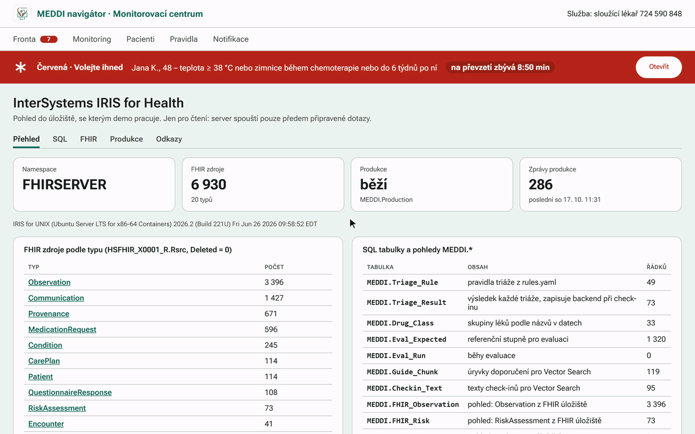
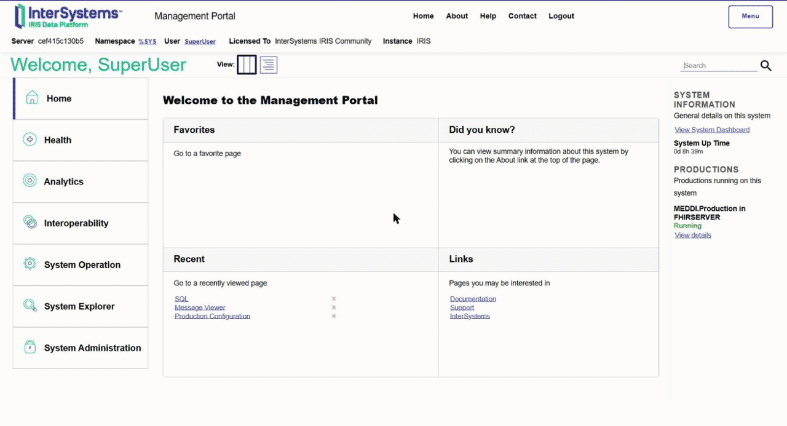
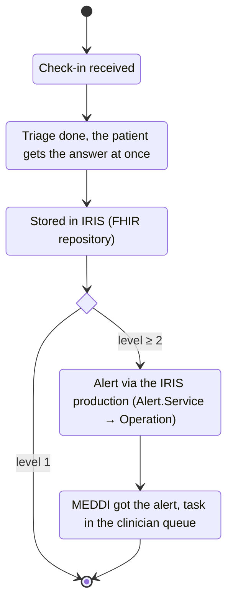
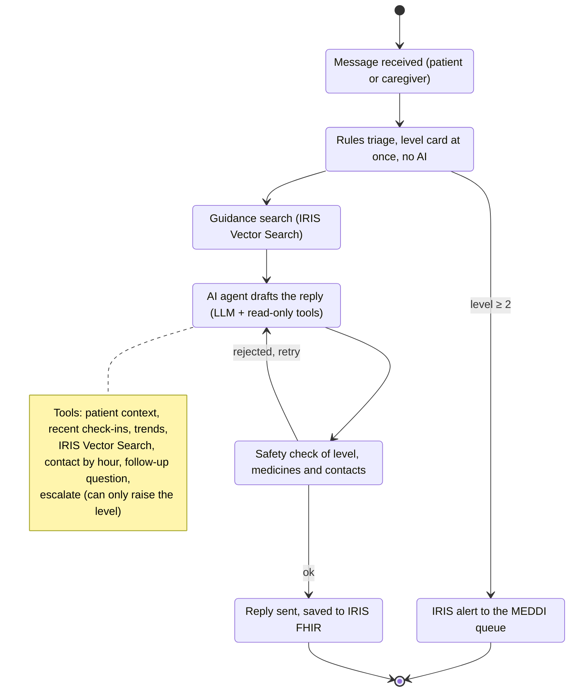

# MEDDIONCO AI Navigator

**A safe companion for people on cancer treatment, for the days between doctor visits.** 
The patient learns what to do next. The care team learns who needs help first.

**[Try the patient app ↗](https://pacient.nastasiya.com/?patient=ONC-001)** ·
**[Open the clinician web ↗](https://lekar.nastasiya.com/#/fronta)** ·
[Technical documentation](docs/README.md)

Jana is on chemotherapy and gets a fever late in the evening. Her phone tells her to call right away;
the doctor on duty sees her at the top of the list with a 15-minute countdown and a short summary.

## See it in action

<table>
  <tr>
    <td width="50%" align="center" valign="top">
      
       <b>Check-in.</b> Jana has a fever ten days after chemotherapy. A few taps later her phone says: call now, and the team already knows.
    </td>
    <td width="50%" align="center" valign="top">
      
       <b>Chat for relatives.</b> A daughter asks about another dose of morphine for her mother. No extra dose without a doctor; when the pain stays at 8, it turns orange.
    </td>
  </tr>
</table>

<b>The care team.</b> Jana's red task is on top with a countdown. One click shows the 30-second summary, her history and the monitoring of all patients.

## Install it like an app

The patient app works on **phones and tablets** and can be added to the home screen. It then has its own icon
and opens full screen like any other app, with no app store needed.

| iPhone and iPad | Android | Computer |
|---|---|---|
| Open [pacient.nastasiya.com](https://pacient.nastasiya.com/) in **Safari**, tap **Share**, then **Add to Home Screen** | Open the link in **Chrome**, tap the menu **⋮**, then **Install app** or **Add to Home screen** | In **Chrome** or **Edge**, click the install icon in the address bar |

On a phone the app is one clear column; on a tablet it fills the whole screen. The clinician web is made for
computers and also opens on tablets and phones.

## Reminders on the phone

The care team decides when patients get a reminder. The patient sees it even on a locked phone, and a tap opens the
right screen.

- **Daily reminder** at a set time for everyone who has not filled in today's check-in.
- **Missed check-in** after a few days without one; a day earlier for high-risk patients.
- **Message from the team** right after the team calls, holds a video consultation or closes the task.
- **Follow-up question** when the navigator needs one more answer.

The texts never contain health data, because they show on the lock screen. The patient turns reminders on in the app
under *Nastavení* → *Zapnout upozornění*; on iPhone and iPad this works in the app added to the home screen
(iOS 16.4 or newer). The team sets the rules and can send a test reminder in
[Notifikace ↗](https://lekar.nastasiya.com/#/notifikace).

## What it looks like

### Patient app

<table>
  <tr>
    <td width="33%" align="center" valign="top">
      
       <b>Check-in first.</b> The app opens on today's questions; the red phone shows the warning signs, <i>AI</i> opens the chat.
    </td>
    <td width="33%" align="center" valign="top">
      
       <b>Questions follow the treatment.</b> This one is asked <i>because of chemotherapy</i>.
    </td>
    <td width="33%" align="center" valign="top">
      
       <b>Red.</b> One clear step, both phone numbers, a warning not to take paracetamol, and a note that the team already knows.
    </td>
  </tr>
  <tr>
    <td align="center" valign="top">
      
       <b>Feeling very bad?</b> The warning signs in plain words and a call button, one tap away.
    </td>
    <td align="center" valign="top">
      
       <b>For relatives.</b> Two doses given and the pain is still 8 of 10 → orange: call the doctor on duty, no extra dose.
    </td>
    <td align="center" valign="top">
      
       <b>In Slovak.</b> The form says no diarrhoea, the message says six times a day → orange and a question back.
    </td>
  </tr>
</table>

### Clinician web

<b>Queue.</b> The most urgent patient is on top with a countdown; a red banner stays on every page until someone takes the task.

<b>Patient detail.</b> Hana D. takes a drug that can strain the heart; her weight rose by 2.4 kg in 6 days, so the team sees it at once.

<b>Monitoring.</b> How many alerts and check-ins came in, day by day; click a day, a treatment or a symptom to see the patients.

<b>More screens</b>

<b>By treatment.</b> Every alert for patients on one drug: why it came and what the team did.

<b>Rules.</b> Who is told and how fast, in and out of working hours; the rules set the colour, AI never does.

## Results

We replayed 1,320 made-up check-ins from the challenge data, day by day, and compared the navigator with the answers
expected by the organisers.

| | Result | Goal of the challenge |
|---|---|---|
| 🔴 Emergencies caught | **100 %** | 100 % |
| Patients rated less urgent than they were | **0 %** | at most 3 % |
| Harmless check-ins sent to the team anyway | **about 3 %** | at most 15 % |
| Colour exactly as expected | **98 %** | at least 85 % |

The full numbers are in the [technical documentation](docs/README.md#metrics).

## InterSystems IRIS for Health

<b>Live from the demo server.</b> The storage overview, a SQL query that reads Hana's weight straight from FHIR,
a triage task stored as a FHIR resource, and the same alert travelling through the IRIS production toward MEDDI.

<b>The same in the IRIS Management Portal.</b> MEDDI.Production is running; the alert operation posts to the
MEDDI endpoint; the message trace of one alert; and a SQL query over the FHIR observations.

Everything the navigator works with is stored in **InterSystems IRIS for Health** in the healthcare standard
**FHIR**: patients, check-ins, triage results, tasks and alerts. Trends are read with SQL straight over the FHIR data,
the chat looks up guidance with IRIS Vector Search, and every alert also goes through an IRIS production toward MEDDI.
That is what lets the navigator connect to existing hospital systems.

**A check-in on its way through IRIS:**

**A chat message and the AI agent.** The level is always set by rules. The AI agent only writes the words, and it can
raise the level but never lower it.

See it live, no login needed: [overview ↗](https://lekar.nastasiya.com/#/iris) ·
[SQL ↗](https://lekar.nastasiya.com/#/iris/sql) · [FHIR resources ↗](https://lekar.nastasiya.com/#/iris/fhir) ·
[production traces ↗](https://lekar.nastasiya.com/#/iris/produkce) · [FHIR API ↗](https://lekar.nastasiya.com/fhir/r4/metadata).
How it is built, how to run it and every rule: [technical documentation](docs/README.md).

> [!NOTE]
> This is a hackathon prototype with made-up data. It is not a medical device. If you feel unwell, call your doctor
> or 155.
