<div align="center">


# MEDDIONCO AI Navigator

**One check-in between oncology visits: the patient learns what to do next, the right clinician learns how fast.**

[](https://www.rakathon.cz/#rv-praha)
[](docs/intersystems.md)
[](docs/fhir-mapping.md)
[](#metrics)
[](#metrics)
[](#triage-rules)

**[Patient app ↗](https://pacient.nastasiya.com/?patient=ONC-001)** ·
**[Clinician web ↗](https://lekar.nastasiya.com/#/fronta)** ·
**[Push test ↗](https://lekar.nastasiya.com/#/test-notifikace?patient=ONC-001)** ·
[Spec](docs/spec.md) · [Architecture](docs/architecture.md) · [InterSystems](docs/intersystems.md)

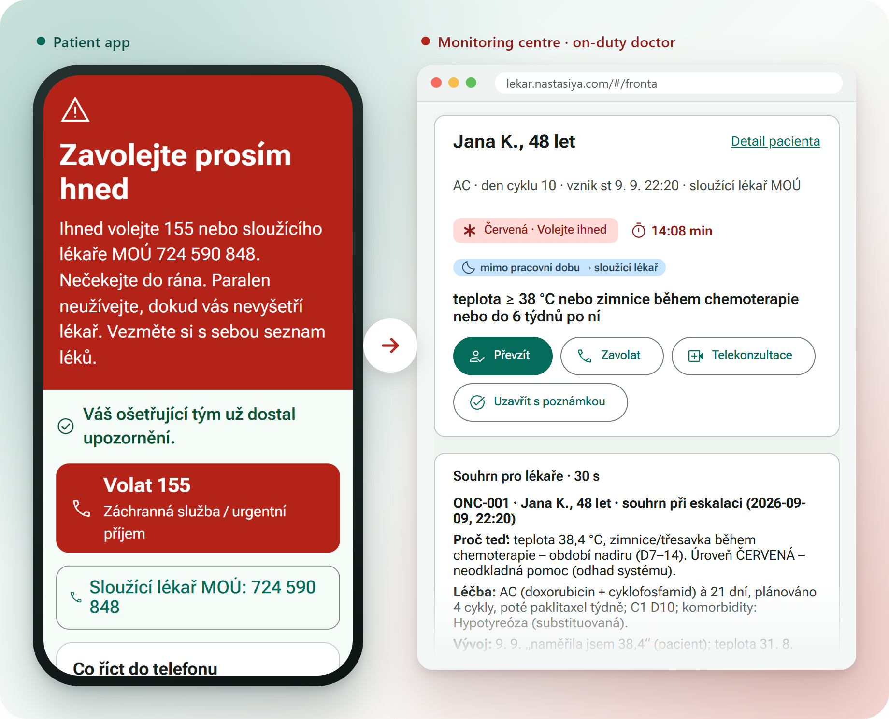

<sub>Jana K., AC cycle 1 day 10 (nadir), reports 38.4 °C and chills at 22:20 → the patient gets one clear step, the on-duty
doctor gets the task with the SLA countdown and a 30-second summary.</sub>

</div>

## The challenge

Our entry for the **MEDDI ONCO Challenge** (challenge 5 of the Prague track, set by MEDDI Hub) at
[Rakathon 2026](https://www.rakathon.cz/#rv-praha), also
submitted to the [InterSystems challenge](https://developer.intersystems.com/intersystems-challenge-at-rakathon-2026/).
The brief: an AI navigator that supports an oncology patient also *between* check-ups. It keeps following the
symptoms, recognises risky changes and recommends a safe next step; when the patient gets worse, it alerts the care
team in time and gives the doctor a short, clear overview of how the patient's condition developed.

| The brief asks for | What the navigator does | See |
|---|---|---|
| Support between check-ups | Patient PWA: a check-in tailored to the treatment, navigator chat in Czech and Slovak with an optional voice mode, caregiver mode, history | [Patient PWA](#patient-pwa) |
| Keep following the symptoms | Every check-in and chat message is read with the earlier days: trends, the patient's own baselines, missed check-ins | [Triage flow](#how-a-check-in-is-triaged) |
| Recognise risky changes | 49 deterministic rules, treatment context (nadir, drug classes), contradictions between the form and the free text | [Triage rules](#triage-rules) |
| Recommend a safe next step | One of four levels with one step and the right phone numbers; validated texts, no diagnosis, no dose changes | [Red card](#patient-pwa) |
| Alert the team in time | A task in the clinician queue with an SLA timer (15 min for red), owned by the monitoring centre in working hours and by the on-duty doctor out of hours; the alert also goes through the IRIS production | [Queue](#clinician-web) |
| A short overview for the doctor | A 30-second summary: why now, treatment, trend, labs, what the patient does not report | [Queue](#clinician-web) |

## How it works

Between visits, a patient on cancer treatment (or a relative) fills in the MEDDI Onco check-in or writes to the
navigator chat. The system reads the answers *together* with the treatment, the trend of earlier days and the
patient's free text (Czech or Slovak), sets one of four levels and routes it to the right person: the patient gets
a clear next step, the monitoring centre or the on-duty doctor gets a task with an SLA timer and a 30-second summary.
Today MEDDI colours every answer on its own; we judge the whole situation.

Safety rules, enforced in code: the patient is never told a diagnosis, doses are never changed or computed, levels
2–4 always end with a health professional, uncertainty escalates, and the LLM never sets or lowers the level
(rules decide; the LLM only extracts quoted facts and polishes validated texts).

| Level | Step | Contact (in hours / out of hours) | SLA |
|---|---|---|---|
| 1 green | další sledování | – | – |
| 2 yellow | kontaktovat tým | monitorovací centrum – vyřízení do konce následujícího pracovního dne / – následující pracovní den | next working day 15:30 |
| 3 orange | telekonzultace dnes | telekonzultace s lékařem MOÚ přes monitorovací centrum do 2 h / sloužící lékař MOÚ 724 590 848 – ihned | 2 h / now |
| 4 red | volejte ihned | 155 / urgentní příjem (případně sloužící lékař MOÚ 724 590 848) | 15 min |

Working hours of the monitoring centre: Mon–Fri 07:00–15:30, Europe/Prague.

## Live demo

Synthetic data only. The demo clock starts on Wed 9 Sep 2026 21:50, out of working hours, so new tasks go to the
on-duty doctor, and then runs in real time (after about 9 hours it reaches Thu 07:00 and new tasks go to the
monitoring centre). A restart of the API resets the clock and the demo state.

| | Link | What to try |
|---|---|---|
| **Patient app** | [pacient.nastasiya.com](https://pacient.nastasiya.com/?patient=ONC-001) | Open it at phone width (or install it); the *DEMO* bar on top switches the patient |
| | [`?patient=ONC-001`](https://pacient.nastasiya.com/?patient=ONC-001) | Jana K., AC cycle 1 day 10 (nadir): the app opens on the check-in; tick *Zvýšená teplota a horečky* and *Únava a slabost*, then *Teplota* 38,4 on the *Naměřené hodnoty* step → red |
| | [`?patient=ONC-018`](https://pacient.nastasiya.com/?patient=ONC-018) | Štefan Ď., Slovak: tick only *Únava a slabost*, message „od vcera mam hnacku asi 6 krat, slaby som“ → orange with a follow-up |
| | [`/navigator?patient=ONC-014`](https://pacient.nastasiya.com/navigator?patient=ONC-014) | Ludmila T., palliative care, her daughter writes: the chat opens in caregiver mode (*Píšete za: maminka*, leave it on) → „Můžu mamince dát další Oramorph?“ |
| **Clinician web** | [lekar.nastasiya.com](https://lekar.nastasiya.com/#/fronta) | Desktop browser; on a tablet or phone it opens scaled down |
| | [`#/fronta`](https://lekar.nastasiya.com/#/fronta) | Queue: level, SLA countdown, task actions, 30-second summary |
| | [`#/monitoring`](https://lekar.nastasiya.com/#/monitoring) | Alerts and check-ins over time, by treatment and by symptom |
| | [`#/monitoring/lecba/sunitinib…`](https://lekar.nastasiya.com/#/monitoring/lecba/sunitinib%2050%20mg%201%C3%97%20denn%C4%9B) | Every alert on sunitinib, why it fired and what the team did |
| | [`#/pacienti`](https://lekar.nastasiya.com/#/pacienti) | Patients sorted by the last level |
| | [`#/pacienti/ONC-001`](https://lekar.nastasiya.com/#/pacienti/ONC-001) | Patient detail: regimen, tags, vitals trends, timeline |
| | [`#/pravidla`](https://lekar.nastasiya.com/#/pravidla) | Routing by working hours, SLA and the rules |
| | [`#/test-notifikace?patient=ONC-001`](https://lekar.nastasiya.com/#/test-notifikace?patient=ONC-001) | Web Push test: on a real phone open the patient app with ONC-001 in the *DEMO* bar (iPhone: add it to the home screen first), *Nastavení* → *Zapnout upozornění*; then send a test notification from here, a tap opens the check-in |
| **API** | [`/api/health`](https://lekar.nastasiya.com/api/health) | Status of IRIS, FHIR, the LLM and the MCP server |
| | [`/mock/meddi/requests`](https://lekar.nastasiya.com/mock/meddi/requests) | Alerts (levels 2–4) that the IRIS production forwarded to the proposed MEDDI endpoint; empty after a restart until a new check-in or chat message reaches yellow or higher |

## What it looks like

### Patient PWA

<table>
  <tr>
    <td width="33%" align="center" valign="top">
      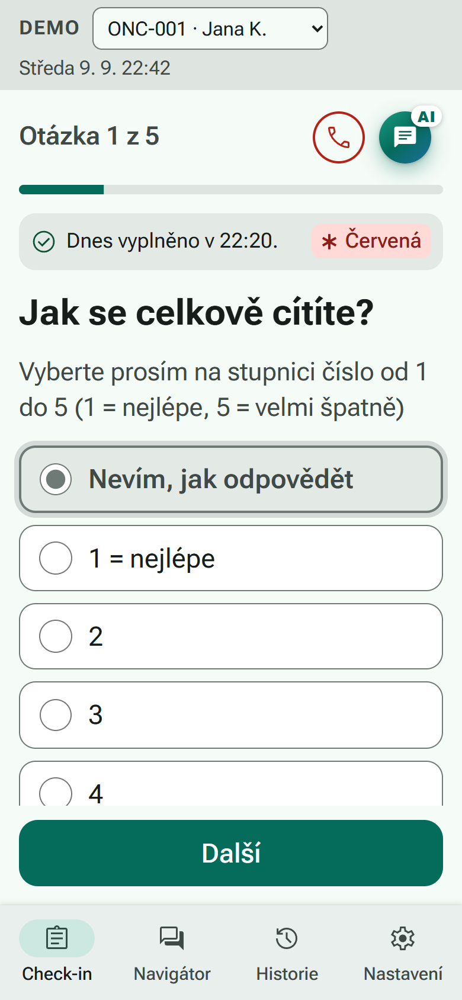
      <br><sub><b>Check-in first.</b> The app opens on today's questions and shows the level of today's check-in; the red phone opens the warning signs, <i>AI</i> the navigator.</sub>
    </td>
    <td width="33%" align="center" valign="top">
      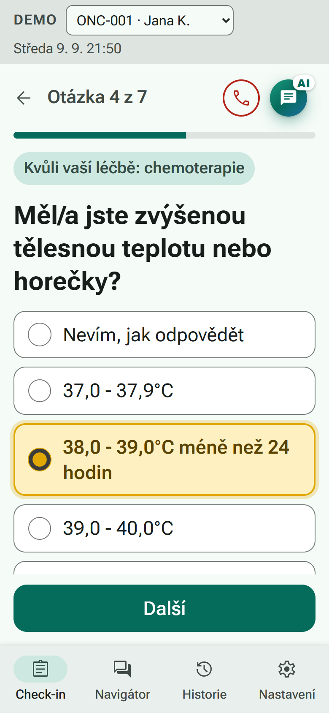
      <br><sub><b>Questions follow the treatment.</b> This one is asked <i>because of chemotherapy</i>.</sub>
    </td>
    <td width="33%" align="center" valign="top">
      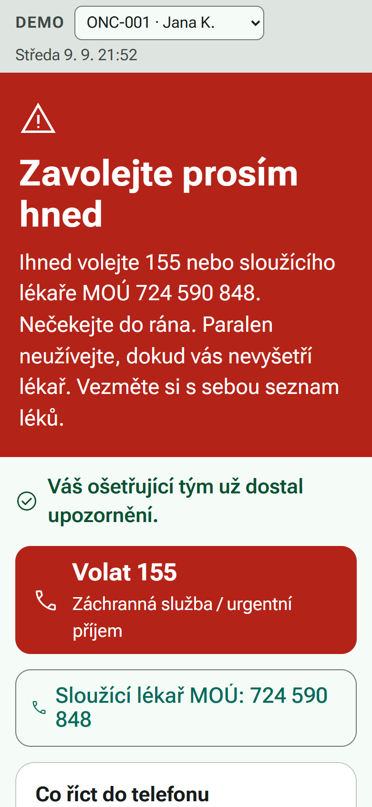
      <br><sub><b>Red.</b> One clear step, both phone numbers, „Paralen neužívejte…“ and a confirmation that the team already knows.</sub>
    </td>
  </tr>
  <tr>
    <td align="center" valign="top">
      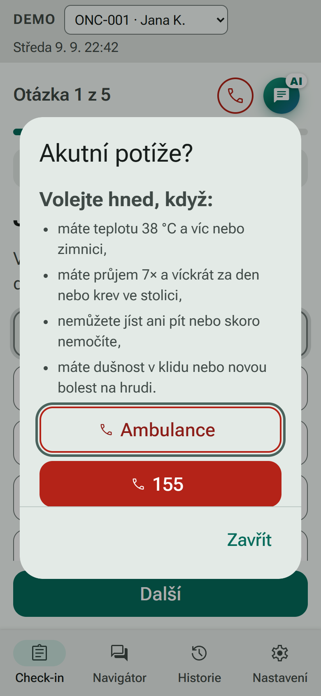
      <br><sub><b>Akutní potíže?</b> The warning signs in plain words with <i>Ambulance</i> and <i>155</i>, one tap from the check-in.</sub>
    </td>
    <td align="center" valign="top">
      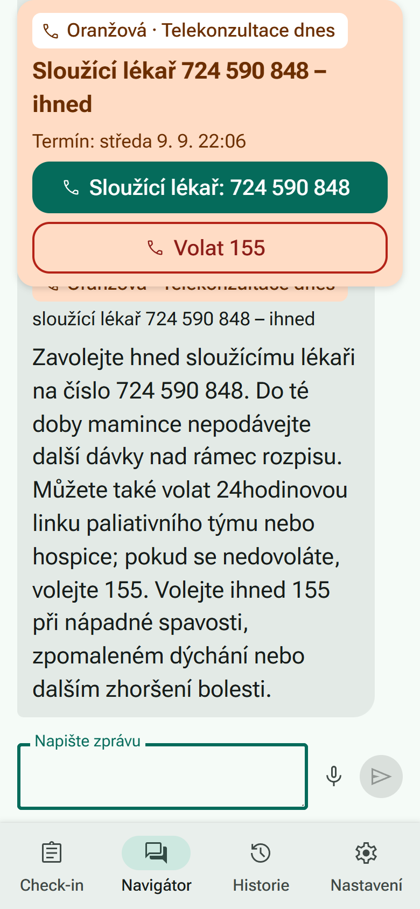
      <br><sub><b>Caregiver mode.</b> After „Dostala už dvě dávky a bolest je pořád 8“ → orange: the on-duty doctor now, no dose beyond the prescription.</sub>
    </td>
    <td align="center" valign="top">
      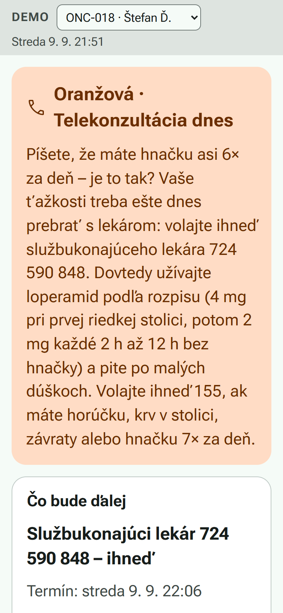
      <br><sub><b>Slovak.</b> The form says no diarrhoea, the text says „hnacku asi 6 krat“ → orange plus a follow-up question in Slovak.</sub>
    </td>
  </tr>
</table>

### Clinician web

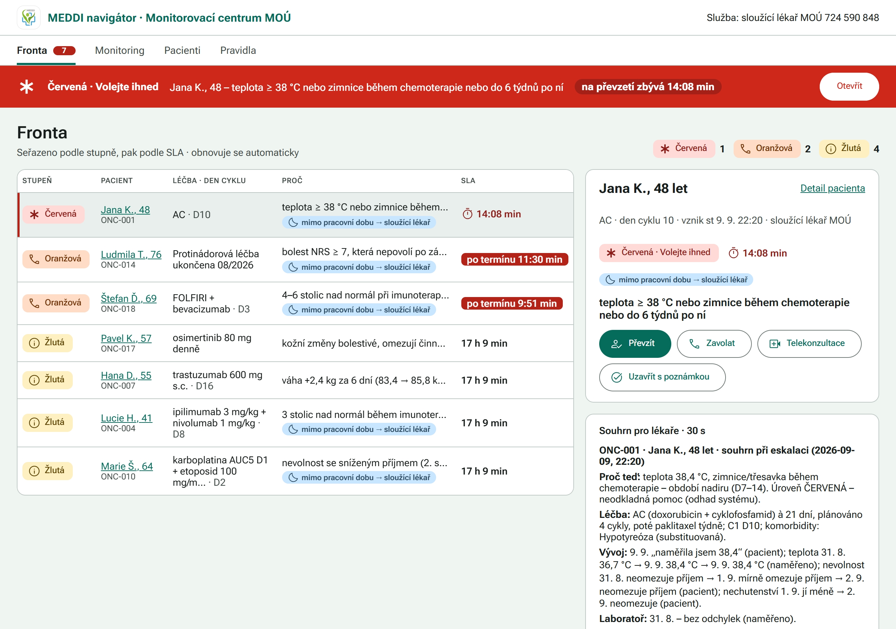

<sub><b>Queue.</b> Sorted by level, then SLA; the red banner stays on every page until someone takes the task over.</sub>

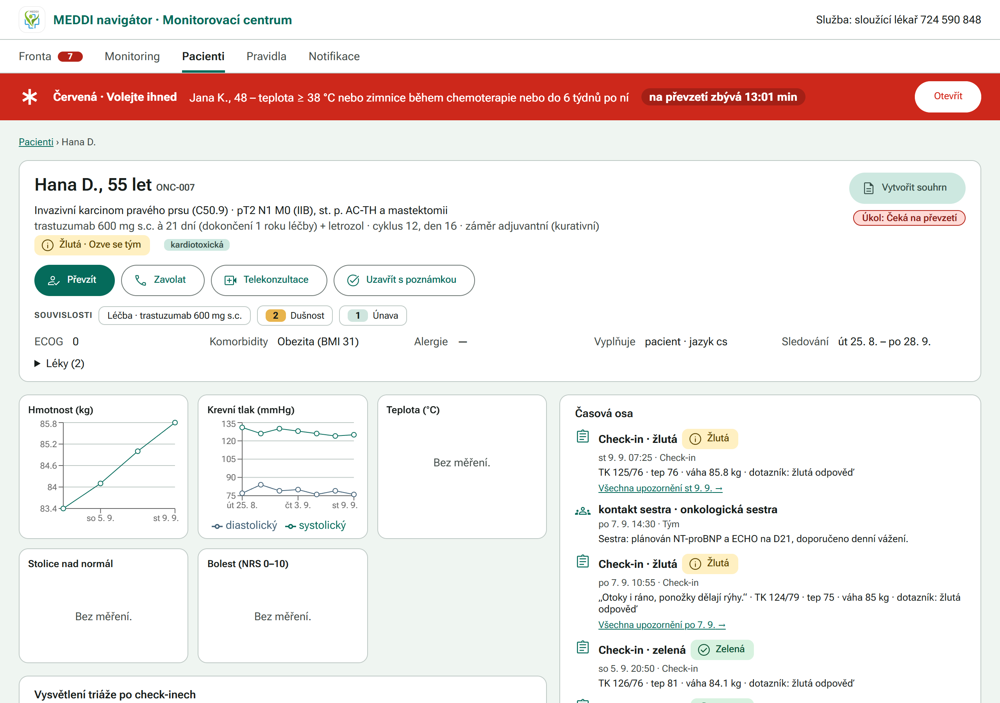

<sub><b>Patient detail.</b> Hana D. on trastuzumab (cardiotoxic): weight 83.4 → 85.8 kg in 6 days, blood pressure, a timeline of check-ins and team notes.</sub>

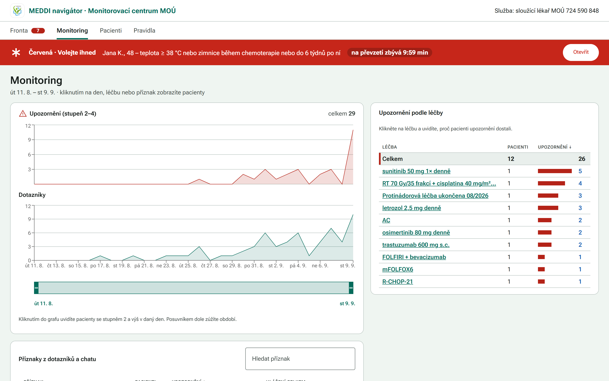

<sub><b>Monitoring.</b> Alerts and check-ins share one range strip; click a day, a treatment or a symptom.</sub>

<details>
<summary><b>More: drill-down by treatment, rules</b></summary>

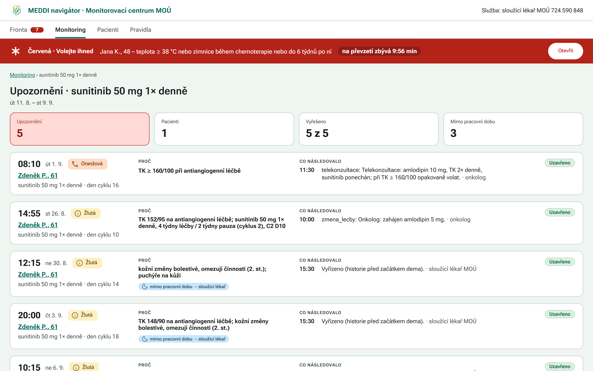

<sub><b>Drill-down by treatment.</b> Every alert on sunitinib: why it fired and what the team did.</sub>

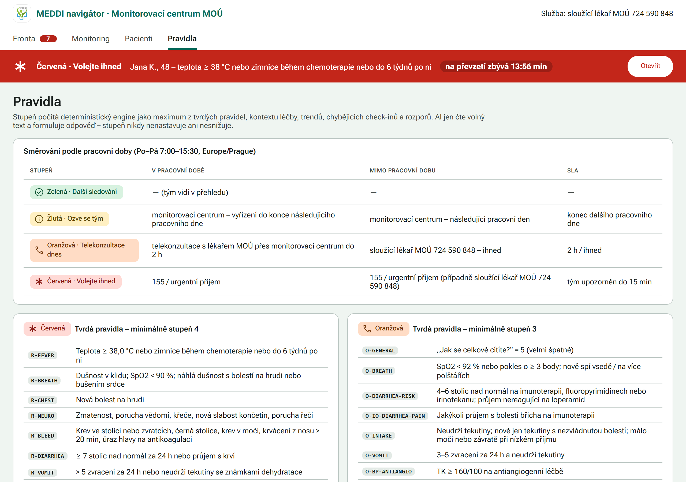

<sub><b>Rules.</b> Routing by working hours and SLA; the engine sets the level, AI never does.</sub>

</details>

### How a check-in is triaged

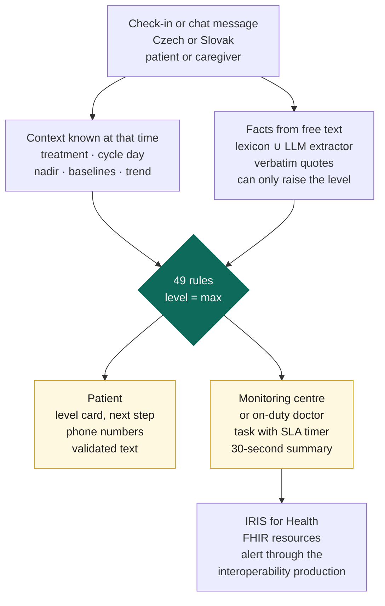

## Repository

| Path | What | Dev port |
|---|---|---|
| `apps/patient-pwa` | PWA for patients: mobile-first, installable, works offline, Czech/Slovak, caregiver mode | 5173 |
| `apps/doctor-web` | Web app for the monitoring centre and doctors, made for desktop; phones and tablets get the desktop layout scaled down | 5174 |
| `packages/ui` | Shared Material 3 library used by both apps | – |
| `packages/api` | TypeScript types of the HTTP API, fetch and SSE helpers | – |
| `backend/` | FastAPI: triage engine, navigator chat, eval, FHIR/IRIS integration | 8100 |
| `backend/app/agent/mcp_server.py` | MCP server with the navigator tools | 8101 |
| `iris/` | InterSystems IRIS for Health container, interoperability production, SQL | 52773, 1972 |
| `docs/` | `spec.md` (product spec), `architecture.md`, `intersystems.md`, `fhir-mapping.md`, `interop.md` | – |

Stack: Python 3.12, FastAPI, OpenAI (`gpt-6-luna`, `text-embedding-3-small`), FastMCP, InterSystems IRIS for Health
Community; React 19, Vite 8, TypeScript 7, pnpm workspaces, `vite-plugin-pwa`, Material Web (`@material/web`).

## Architecture

```text
 Patient PWA :5173                  Clinician web :5174
 check-in, result card,             queue + SLA timers, monitoring, patient detail,
 navigator chat (SSE), history      drill-downs by day, treatment, symptom; rules
        │  /api (Vite proxy)                 │
        ▼                                    ▼
 ┌──────────────────────────── FastAPI :8100 (backend/app) ───────────────────────────────┐
 │ api/        checkins · chat (SSE) · queue · patients · stats · replay · eval · mock    │
 │ store.py    demo clock, live check-ins, tasks, chat (in memory, replays history)       │
 │ context/    build_context: only data known at as_of, baselines, drug classes, nadir    │
 │ nlu/        cs/sk lexicon  ∪  LLM fact extractor (closed fact list, verbatim quotes,   │
 │             disk cache) → facts can only raise the level                               │
 │ triage/     rules.yaml (49 rules) → engine (max level, trends, contradictions,         │
 │             missed check-ins) → router (§8.2 strings, SLA) → responder + validator     │
 │ summary/    deterministic 30-second doctor summary (optional LLM draft behind a gate)  │
 │ agent/      navigator: triage first, level card, then LLM answer with tools,           │
 │             guardrails, retry, safe template; Vector Search RAG                        │
 │ eval/       chronological replay of dev + extended sets, §13 metrics                   │
 └───────┬──────────────────┬──────────────────────┬──────────────────────┬───────────────┘
         │ FHIR REST (PUT)  │ DB-API SQL            │ native API           │ HTTP
         ▼                  ▼                       ▼                      ▼
 ┌──────────────────── InterSystems IRIS for Health (meddi-iris) ─────────────────────────┐
 │ FHIR R4 repository /fhir/r4: Patient, CarePlan, MedicationRequest, Observation,        │
 │   QuestionnaireResponse, RiskAssessment, Task, Flag, Composition, Communication,       │
 │   Provenance …                                                                         │
 │ SQL: MEDDI.Triage_Rule, Triage_Result, Drug_Class, Eval_Expected; views over FHIR      │
 │ Vector Search: MEDDI.Guide_Chunk, MEDDI.Checkin_Text (HNSW, cosine)                    │
 │ Interoperability MEDDI.Production:                                                     │
 │   iris/inbox/*.hl7 → LabHL7.Service → HL7→SDA3 → SDA3→FHIR → repository                │
 │   Alert.Service → Alert.Operation → POST /mock/meddi/requests (MEDDI proposal)         │
 └────────────────────────────────────────────────────────────────────────────────────────┘
 MCP server :8101 (streamable HTTP) exposes the same read-only, pseudonymised tools to any agent.
```

Details: `docs/architecture.md` (modules, interfaces, HTTP API), `docs/intersystems.md` (every IRIS feature and
where it is used).

## Quick start (Windows)

Needs Docker Desktop, Python 3.12 with `uv` (or pip), Node ≥ 22.12, pnpm 11, Git Bash. Put `OPENAI_API_KEY=...` into
`.env` in the repo root (not needed for the rules-only eval; the NLU cache in `backend/cache` makes the LLM eval
work offline).

```bash
# 1. IRIS for Health (first build takes a few minutes), then the interoperability production
docker compose up -d --build
sh iris/scripts/install.sh

# 2. Python backend
cd backend
uv venv .venv --python 3.12
uv pip install --python .venv/Scripts/python.exe -r requirements.txt
cd ..

# 3. Seed IRIS: FHIR resources of both datasets, MEDDI.* SQL tables, Vector Search tables (~20 s)
bash scripts/seed.sh --datasets dev,rozsirena --reset

# 4. Evaluate (writes backend/reports/eval_<dataset>.json, shown in the clinician web)
bash scripts/eval.sh all            # LLM facts from the cache
bash scripts/eval.sh all --no-llm   # rules + lexicon only

# 5. Run (one terminal each)
DEMO_WRITE_FHIR=1 bash scripts/run-api.sh                       # API :8100, demo clock Wed 9 Sep 2026 21:50
cd backend && PYTHONPATH=. .venv/Scripts/python.exe -m app.agent.mcp_server   # MCP :8101
pnpm install && pnpm dev:patient                                # http://localhost:5173/?patient=ONC-001
pnpm dev:doctor                                                 # http://localhost:5174/#/fronta
```

Other commands: `pnpm build`, `pnpm typecheck`, `pnpm test`; backend tests
`cd backend && PYTHONPATH=. PYTHONIOENCODING=utf-8 .venv/Scripts/python.exe -m pytest tests -q` (411 tests; the live
IRIS and LLM tests skip or use the cache when those are down). Refresh the LLM NLU cache after a prompt change:
`python -m app.nlu.llm_extractor --precompute all` (~1 min).

API environment: `DEMO_NOW` (default `2026-09-09T21:50:00+02:00`), `DEMO_DATASET` (`dev`|`rozsirena`), `DEMO_REPLAY=0`
skips the history replay at start, `DEMO_WRITE_FHIR=1` also writes the replayed history into IRIS FHIR.
`POST /api/demo/state {"now": "...", "dataset": "dev"}` resets the live state. A restart also resets it, so restart the
API right before a demo.

## Demo script (6 minutes)

Before: `bash scripts/seed.sh --datasets dev,rozsirena --reset`, start API, MCP and both UIs. Phone = patient PWA at
375 px (browser device mode), desktop = clinician web at 1440 px.

1. **Problem.** MEDDI Onco colours each answer on its own; a fever in nadir, a creeping weight gain on trastuzumab or a
   contradiction between the form and the message gets lost.
2. **Fever in nadir.** PWA `?patient=ONC-001` (Jana, AC C1 D10) opens on the check-in → tick *Zvýšená teplota* and
   *Únava*, temperature `38,4`, message „Od odpoledne mi je zima a třese mě, naměřila jsem 38,4.“ → red full-screen
   card: *Zavolejte prosím hned*, call 155 and the on-duty doctor, „Paralen neužívejte…“, a phone script. Clinician web
   *Fronta*: pulsing red banner, task for the on-duty doctor with a 15-minute countdown and the escalation summary in
   the sample format; the alert also went through the IRIS production to `/mock/meddi/requests`.
3. **Monitoring.** Red alert chart and green questionnaire chart share one range strip; *Upozornění podle léčby* →
   *sunitinib 50 mg* → all five alerts of Zdeněk P. with the reason and what the team did.
4. **Slovak contradiction.** PWA `?patient=ONC-018` → check-in, symptoms only *Únava*, message
   „od vcera mam hnacku asi 6 krat, slaby som“ → orange (C-CONTRADICTION: the form says no diarrhoea, the text says 6×)
   with the follow-up „Píšete, že máte hnačku asi 6× za deň – je to tak?“ → *Odpovedať* → „Uz je to lepsie, dnes len
   3 krat“ → the navigator re-triages with the answer: yellow (Y-IRINOTECAN), next working day. The open orange task is
   not lowered automatically; a person closes it.
5. **Caregiver guardrail.** PWA `?patient=ONC-014` → *Navigátor* (opens in caregiver mode, *Píšete za: maminka*) → „Můžu mamince dát další
   Oramorph?“ → no permission, the prescription quoted verbatim („Morfin roztok (Oramorph) 10 mg, max 6× denně“),
   the 24h palliative team or hospice line, then 155, and the question how many doses were given; answer „Dostala už
   dvě dávky a bolest je pořád 8“ → orange (O-PAIN), on-duty doctor.
6. **Metrics.** `bash scripts/eval.sh` replays both sets and writes `backend/reports/eval_*.json` (table below).
7. **InterSystems in 60 s** (`docs/intersystems.md`): FHIR resources of ONC-001 in the portal or
   `GET /fhir/r4/Observation?patient=ONC-001`; the SQL weight trend of ONC-007 over the FHIR view; a Vector Search hit
   (`python -m app.agent.vectors --search "mam hnacku" --lang sk`); the MCP tool-call log `backend/logs/mcp.log`; the
   production page, then `python -m app.interop.hl7 --patient ONC-001 --new` → 10 new lab Observations and the
   message trace; the alert from step 2 in the message viewer.
8. **Integration.** MEDDI keeps its app; we read and write FHIR and propose one `POST /requests` endpoint (spec §11).

## Metrics

Chronological replay, the engine sees only data known at the time of each check-in. Run on 17 Oct 2026.

| Metric (spec §13) | dev, rules only | extended, rules only | dev, LLM | extended, LLM | Target |
|---|---|---|---|---|---|
| Check-ins | 171 | 1 149 | 171 | 1 149 | |
| Red recall (GT 4 → 4) | 100 % | 100 % | 100 % | 100 % | 100 % |
| Orange recall (GT 3 → ≥ 3) | 100 % | 100 % | 100 % | 100 % | ≥ 95 % |
| Under-triage by ≥ 2 levels | 0 | 0 | 0 | 0 | 0 |
| Under-triage overall | 0.0 % | 0.0 % | 0.0 % | 0.0 % | ≤ 3 % |
| False alarms (GT 1 → ≥ 2) | 2.6 % (3/115) | 2.8 % (21/752) | 3.5 % (4/115) | 3.6 % (27/752) | ≤ 15 % |
| False alarms ≥ 3 | 0 % | 0 % | 0 % | 0 % | reported |
| `upozornit_tym` agreement | 98.2 % | 98.2 % | 97.7 % | 97.7 % | ≥ 95 % |
| Routing (contact category) | 98.2 % | 98.2 % | 97.7 % | 97.7 % | ≥ 95 % |
| Routing, exact string | 98.2 % | 98.2 % | 97.7 % | 97.7 % | reported |
| Exact level | 98.2 % | 98.2 % | 97.7 % | 97.7 % | ≥ 85 % |
| Patient texts passing the validator | 100 % | 100 % | 100 % | 100 % | 100 % |

Confusion matrices (rows ground truth 1–4, columns predicted 1–4): dev rules-only `112 3 0 0 / 0 37 0 0 / 0 0 13 0 /
0 0 0 6`; extended rules-only `731 21 0 0 / 0 262 0 0 / 0 0 92 0 / 0 0 0 43`; dev LLM `111 4 0 0 / …diagonal`;
extended LLM `725 27 0 0 / …diagonal`. Every error is a yellow over-triage of a green check-in. Reports:
`backend/reports/eval_{dev,rozsirena}.json` (LLM run) and `eval_*_rules_only.json`.

Latency: triage of a check-in 0.01 s with a warm NLU cache, about 2.5 s with a live LLM call; the chat level card
arrives in about 0.15 s also for new texts (rules-only triage first; a second card follows only if the LLM
facts raise the level), the validated answer in 2–4 s (first token is not streamed before the guardrails pass). Full replay of 1 320 check-ins: about 3 s.

## Triage rules

`backend/app/triage/rules.yaml` holds 49 rules, each with id, minimum level, area, source in the MEDDI rules, clinician
label, rationale and cs/sk patient hint; the same rows are in IRIS as `MEDDI.Triage_Rule`.

| Group | Level | Rules |
|---|---|---|
| Red flags (`R-*`) | 4 | fever ≥ 38 °C or chills during chemo or ≤ 6 weeks after; resting dyspnoea / SpO2 < 90 %; new chest pain; confusion, seizure, new weakness or speech problem; bleeding (blood in stool/vomit/urine, black stool, nosebleed > 20 min, head injury on anticoagulants); ≥ 7 stools or bloody diarrhoea; > 5 vomits or fluids not kept with dehydration; no urine > 10 h, fainting, SBP < 90; ileus; BP ≥ 180/110 or high BP with neuro signs; DKA pattern; opioid somnolence or slow breathing; suicidal thoughts with plan, intent or means |
| Orange (`O-*`) | 3 | feeling „very bad“; SpO2 < 92 % or new orthopnoea; 4–6 stools on IO, fluoropyrimidines or irinotecan, or refractory to loperamide; IO diarrhoea with abdominal pain; poor intake; 3–5 vomits not keeping fluids; BP ≥ 160/100 on antiangiogenics; any bleeding on anticoagulants; one-sided calf swelling; NRS ≥ 7 despite a rescue dose; morning headache with vomiting (brain tumour); IO endocrinopathy signs; hypoglycaemia on insulin; passive death wish or hopelessness; any grade-3 symptom |
| Yellow (`Y-*`) | 2 | fever outside the chemo window; grade-2 symptom; IO diarrhoea ≤ 3 stools; new cough, dyspnoea or thirst on IO; unresolved diarrhoea after irinotecan; 3–5 vomits while drinking; BP above the patient's usual values or orthostatic hypotension; glucose > 15; persistent or function-limiting neuropathy; oedema or > 2 kg gain on cardiotoxic drugs; ≥ 5 % weight loss or falling self-care; NRS 4–6 or ≥ 3 rescue doses; moderate distress; caregiver strain; missed medication; missed check-ins (3 in a row, 2 for high-risk); uncertain free-text red flag (asks back) |
| Context | ±0 / +1 | drug classes (IO, fluoropyrimidine, irinotecan, anticoagulant, antiangiogenic, cardiotoxic, opioid), nadir D7–14, 42-day chemo window, patient's own baselines, team events (drug stopped → rule off), contradiction between form and text → worse variant plus a follow-up question |

The level is the maximum over all fired rules; the LLM facts are unioned with the lexicon facts, so they can only add.

## Limitations

- Synthetic data only; not a medical device. Thresholds come from the MEDDI rules and the dev/extended ground truth,
  not from clinical validation.
- The live state (check-ins posted live, tasks, chat) is in memory and resets on API restart; FHIR keeps a copy.
- The hidden evaluation set may contain phrasings the lexicon does not know; then the LLM extractor carries the case
  (with a warm cache the eval is deterministic, live calls are not).
- No holiday calendar for working hours; the monitoring-centre phone number in `/api/contacts` is a placeholder to confirm.
- FHIR SQL Builder projections are set up by hand in the portal; the scripted SQL access uses our views over the FHIR
  resource table (`MEDDI.FHIR_*`).
- Team actions from the queue (accept, call, close) are not yet written back to FHIR.
- Material Web bundles are large (patient PWA ~830 kB JS); not tested as an installed PWA on a real phone.

## Material 3 (`@navigator/ui`)

- Components: `import { FilledButton, OutlinedTextField, NavigationBar } from '@navigator/ui'`. These are typed React
  wrappers over Material Web elements; events are `onInput`, `onChange`, `onClosed`, `onActivated` and so on.
- Styles: import `@navigator/ui/styles.css` once per app. It brings M3 color tokens (`--md-sys-color-*`),
  Roboto Flex and the type scale classes (`md-typescale-body-large`, `md-typescale-title-medium`, ...).
- Icons: pick one at [fonts.google.com/icons](https://fonts.google.com/icons), then
  `import icon from '@material-symbols/svg-400/outlined/<name>.svg?raw'` and render `<SvgIcon svg={icon} />`.
  Only imported icons are bundled.
- Brand color: change `SEED` in `packages/ui/scripts/tokens.mjs` and run `pnpm --filter @navigator/ui tokens`.
  The apps always use the light scheme (`color-scheme: light` in the generated tokens), whatever the OS setting is.
- Material Web is in maintenance mode and has no top app bar, data table or date picker. Build those from the tokens
  (see `apps/*/src/app.css`); use `<input type="date">` for dates.
